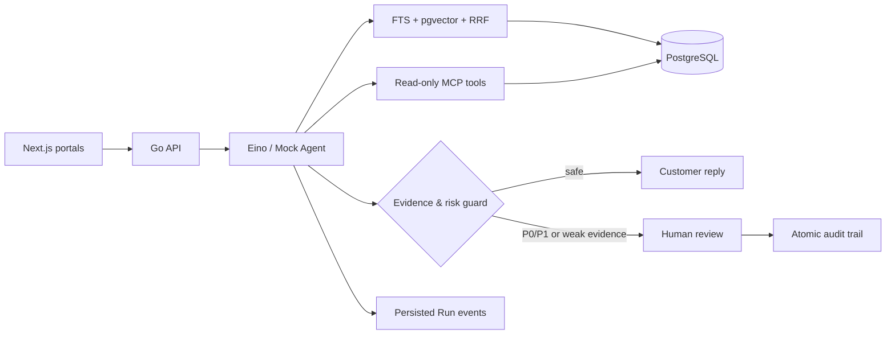

# Eino Support Copilot

> 一个可观测、可评测、带人工审核闭环的 AI 客服系统。使用 Go、Eino、MCP、PostgreSQL/pgvector 与 Next.js 构建。

[](https://github.com/guiyangyuan/eino-support-copilot/actions/workflows/ci.yml)
[](go.mod)
[](go.mod)
[](LICENSE)


## 业务问题

普通聊天机器人能生成文字，但客服场景还需要回答四个问题：依据是什么、业务状态是否真实、执行过程能否追踪、风险答案由谁负责。

这个项目实现了一条完整闭环：客户提问 → 混合检索 → 只读 MCP 工具 → 结构化草稿 → 证据/风险门禁 → 人工审核 → 可审计回复。全部业务数据与知识文档均为合成示例，不包含任何公司代码、生产数据或内部信息。


## 90 秒 Demo

```bash
cp .env.example .env
docker compose up --build -d --wait
make seed
```

打开 [http://localhost:3000](http://localhost:3000)：

1. 在 Customer Portal 输入 `My Pro payment succeeded but workspace is still Free`；
2. 查看意图识别、知识检索、MCP 工具、引用和草稿事件；
3. P1 门禁要求人工审核，点击“创建工单”；
4. 进入 Agent Workspace，核对引用与业务事实后“批准并发送”；
5. 在 Evaluation 页面运行 24 条确定性合同测试。

完整讲解见 [三分钟演示脚本](docs/demo-script.md)。

## 架构



更完整的运行拓扑、时序与设计权衡见 [Architecture](docs/architecture.md)。

## 为什么不是普通 Chat Wrapper

| 能力 | 实现 |
|---|---|
| Agent runtime | Eino `ChatModelAgent`，严格 JSON 输出，一次修复与有限重试 |
| RAG | PostgreSQL FTS + pgvector 双路召回，RRF 融合，最多 6 条可追溯引用 |
| MCP | 独立 Streamable HTTP Server，账户/支付/服务状态三个只读工具 |
| Human-in-the-loop | P0/P1、低置信度、缺证据或工具失败触发人工审核 |
| Observability | SSE 事件同时持久化；Run 可查看、脱敏、重放和关联来源 |
| Evaluation | 24 条 Golden Dataset、逐例评分、分子/分母指标、数据集哈希和 commit SHA |
| Safety | Demo 身份隔离、工具只读、敏感参数递归遮罩、错误信息安全化 |

## Mock 快速开始

要求：Docker Desktop / Docker Engine + Compose v2。

```bash
docker compose up --build -d --wait
make seed
make e2e
```

常用入口：

- `/customer` — 客户对话与可观测过程
- `/workspace` — 客服队列、证据核验和人工审核
- `/knowledge` — Markdown/TXT/文本型 PDF 上传与索引状态
- `/evaluations` — 可重复评测与逐例结果
- `/runs/{id}` — Run 时间线与安全重放

停止并保留数据库：`make down`。彻底移除示例卷：`docker compose down -v`。

## 真实模型配置

系统兼容 OpenAI-compatible Chat Completions API。复制 `.env.example` 后设置：

```dotenv
APP_MODE=openai-compatible
MODEL_BASE_URL=https://your-compatible-endpoint/v1
MODEL_API_KEY=replace-me
MODEL_NAME=your-model
```

然后重新执行 `docker compose up --build -d --wait`。不要提交 `.env`；仓库已忽略本地密钥文件。

## 评测结果

```bash
make eval
```

Mock 基线当前通过 24/24 条用例，覆盖订阅、支付、成员权限、发票、服务状态和无证据转人工。它验证的是编排、Schema、评分器和 UI 合同的确定性，**不是模型效果宣称**。真实模型结果必须同时记录模型名、配置、commit SHA、dataset hash 和 UTC 时间，且不得用 Mock 数字代替。

完整的机器可读基线见 [`docs/evaluation/mock-baseline.json`](docs/evaluation/mock-baseline.json)，可使用同一命令重新生成。

指标包含 intent accuracy、tool name/argument accuracy、citation precision、evidence-grounded answer rate、unsupported refusal rate、schema pass rate、TTFT 与 total latency。所有比例均保存分子和分母；无样本显示“尚未测量”。

## 安全边界

- 仅包含生成的 SaaS 账户、支付、服务状态与知识文档；无真实用户或雇主数据。
- MCP 工具全部只读，不执行退款、删除、改套餐等破坏性动作。
- P0/P1、低置信度、缺引用或工具失败不会自动发送答案。
- Run API 递归遮罩 `api_key`、`token`、`password`、`authorization` 和 `secret`。
- UI 只显示阶段、工具名和安全摘要，不展示隐藏 prompt 或 chain-of-thought。
- `X-Demo-User` 仅用于本地演示；生产部署应替换为 OIDC、租户隔离、权限策略与限流。

## 开发与验证

```bash
make test             # Go + Web tests
make integration-test # PostgreSQL/pgvector integration tests
make eval             # deterministic Mock evaluation
make e2e              # browser-level customer-to-agent flow
```

CI 在 Pull Request 上运行 Go tests/vet、Web tests/build 和 Compose + Playwright 核心路径。

## 路线图

- OpenTelemetry trace export and production dashboards
- Real-model regression thresholds and comparative evaluation
- OIDC, tenant isolation, rate limits, and production audit retention
- Multilingual knowledge parsing and reranking
- Background indexing queue for larger corpora

## License

[MIT](LICENSE)
