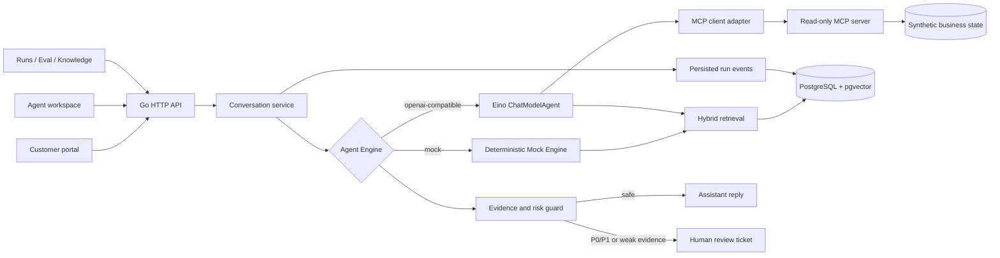

# Architecture

Eino Support Copilot is a synthetic SaaS support system designed around evidence, observable execution, and explicit human control. It contains no employer code, production data, or proprietary prompts.

## Runtime topology

## Request sequence

1. The customer message is persisted before execution begins.
2. The Agent Run is created in `running` state.
3. Classifier, retrieval, MCP tool, citation, and draft events are persisted before being streamed to the browser.
4. The guard evaluates priority, confidence, citations, facts, and tool failures.
5. Safe answers are appended to the conversation. Risky answers become `waiting_review` and are never sent automatically.
6. Agent approval atomically writes an audit record, final message, Ticket state, and Run state.

## Evidence model

- Retrieval combines PostgreSQL full-text search and pgvector candidates with reciprocal rank fusion.
- Every citation carries a document name, locator, excerpt, and stable chunk ID.
- Business facts only come from three schema-validated read-only tools.
- The UI shows safe stage and tool summaries; hidden prompts and chain-of-thought are never exposed.

## Reliability choices

- All state transitions are persisted in PostgreSQL.
- Human review is a single database transaction.
- Model output has strict JSON validation and one repair attempt.
- Transient model and MCP errors have bounded retries; permanent errors do not retry.
- Run replay creates a linked Run and never mutates the source Run.
- Tool arguments are recursively redacted before Run API responses.

## Evaluation boundary

`mock` mode is a deterministic contract test for orchestration, schemas, scoring, and UI behavior. It is not a claim about model quality. Real-model evaluation requires `openai-compatible` mode and results produced with a named model/configuration.
